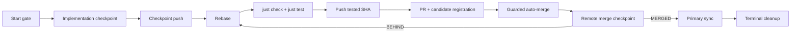

# Dagu issue lifecycle

Rootline uses one repository-owned workflow,
[`.workspace/dagu/dags/feature.yaml`](../.workspace/dagu/dags/feature.yaml), with
Dagu v2.19.2 installed as a user-level service. The workflow coordinates local
quality gates and GitHub auto-merge; hosted CI and release workflows remain the
remote authority.

## Ownership model

The user installation owns common runtime concerns:

- the `dagu` binary and LaunchAgent running `dagu start-all`;
- server, scheduler, authentication, and retention configuration;
- run history, queue data, and logs.

The repository owns all Rootline behavior in `feature.yaml`. The DAG carries the
`workspace=rootline` label and uses the explicit `rootline` queue. A queue with
no global override has concurrency one, which serializes active repository
mutations. Processless `human.task` checkpoints release that slot while an agent
works or GitHub runs hosted checks.

Keep `dagu` on `PATH` and point `DAGU_HOME` at the same home used by the user
service when the installation differs from Dagu's default. Confirm the service
and workflow before enqueuing work:

```sh
just dagu-version
just dagu-validate
```

Local macOS results complement the required hosted Linux, macOS, and Windows
checks; the GitHub `candidate` check remains the required merge gate.

## Enqueue one issue

Start from a clean primary checkout on `master`. Choose an external worktree path
and one issue branch, then enqueue one durable run:

```sh
just dagu-enqueue \
  issue-346 \
  346 \
  "$PWD" \
  "$HOME/.local/share/rootline/worktrees/issue-346" \
  dagu/issue-346
```

Arguments are `RUN_ID ISSUE PRIMARY WORKTREE BRANCH [PR_NUMBER]`. Supply
`PR_NUMBER` when adopting an existing open PR whose head branch and exact head
SHA belong to this run. The equivalent direct invocation is:

```sh
dagu enqueue --run-id issue-346 .workspace/dagu/dags/feature.yaml -- \
  ISSUE=346 \
  PRIMARY="$PWD" \
  WORKTREE="$HOME/.local/share/rootline/worktrees/issue-346" \
  BRANCH=dagu/issue-346 \
  PR_NUMBER=""
```

Dagu stores a snapshot of the definition and the run state. Resume the same run
through its checkpoints instead of starting replacement runs for later phases.

## Lifecycle



1. **Start gate.** The primary checkout must be clean and on `master`. The DAG
   fetches and fast-forwards it, then creates or adopts the named branch and
   worktree.
2. **Implementation checkpoint.** The run enters `Waiting`. Implement and commit
   issue scope in the assigned worktree. A clean commit is required before
   resuming:

   ```sh
   just dagu-complete issue-346 implement
   ```

3. **Local close gate.** The DAG checkpoints the commit remotely, rebases it on
   current `origin/master`, runs `just check && just test` with umask `0022` and
   GitHub token environment variables removed, then pushes the exact tested SHA.
4. **PR gate.** The DAG adopts the supplied PR or creates the branch PR, waits
   for the `candidate` check to register, and enables squash auto-merge with
   `--match-head-commit` bound to the tested SHA.
5. **Remote merge checkpoint.** `await_merge` enters processless `Waiting` while
   GitHub runs hosted checks and applies auto-merge.
6. **Primary synchronization.** After `MERGED`, the close gate verifies the PR
   head, successful required `candidate` check, and tested SHA before
   fast-forwarding local `master` to `origin/master`.
7. **Terminal cleanup.** `handler_on.exit` removes this run's worktree and local
   branch after success, failure, or abort.

## Reconcile the remote checkpoint

Assign remote observation to a separate worker or process so the implementation
agent does not wait for hosted CI. The reconciler repeatedly reads the PR without
holding a Dagu queue slot:

```sh
gh pr view dagu/issue-346 \
  --json number,state,mergeStateStatus,headRefOid,autoMergeRequest
```

Apply exactly one transition from the current observation:

- `MERGED`: complete `await_merge`; the close gate performs final verification.

  ```sh
  just dagu-complete issue-346 await_merge
  ```

- `OPEN` with `mergeStateStatus=BEHIND`: read the waiting task's current
  push-back iteration from Dagu, then rewind with optimistic concurrency:

  ```sh
  just dagu-push-back issue-346 ITERATION
  ```

  The same run resumes at `rebase`, reruns the local gate, pushes the new tested
  SHA, waits for `candidate` registration, and re-enables guarded auto-merge.

- `OPEN` with `mergeStateStatus=CLEAN` and auto-merge enabled: retain `Waiting`
  and observe again after hosted checks advance.

A changed PR head, conflict, failed required check, or unexpected terminal state
is a failed reconciliation. Preserve the waiting run and its evidence for
inspection rather than completing the checkpoint.

The `--expected-iteration` value in `dagu-push-back` prevents two reconcilers
from rewinding the same task. Every successful push-back increments the task
iteration, so read it again before another transition.
