# Dagu issue lifecycle

Rootline versions two repository-owned workflows:

- [`.workspace/dagu/dags/feature.yaml`](../.workspace/dagu/dags/feature.yaml) carries an issue from triage through merge and cleanup.
- [`.workspace/dagu/dags/poc.yaml`](../.workspace/dagu/dags/poc.yaml) proves uncertain external or runtime behavior before implementation.

The adopted bundle is `@a4s/omp-dagu@0.2.0` from
`pablontiv/a4s@3654f1646aba40298a6cd7ade2812c91acf94a84` (`3654f16`),
rendered by `bootstrap-rootline-v0-2-0` with Dagu `2.19.2`. Both DAGs start with
the `# dagu-feature-bundle:` identity header and carry
`dagu-feature-bundle=0.2.0` in their labels. `start_gate` and PoC `base` log
the bundle, source, and bootstrap identity.

Inspect the installed bundle and its adoption history with:

```sh
head -1 .workspace/dagu/dags/feature.yaml .workspace/dagu/dags/poc.yaml
grep -n 'dagu-feature-bundle=0.2.0' .workspace/dagu/dags/*.yaml
git log --format='%h %(trailers:key=Dagu-Feature-Bundle,valueonly)' -- .workspace/dagu/dags
git log -G '^# dagu-feature-bundle:' -p -- .workspace/dagu/dags
```

A user-level Dagu service owns scheduling, history, queues, and logs. The shared
scheduled `reconcile.yaml` in `DAGU_HOME/dags/` owns remote merge transitions for
all repositories. Point the invoking shell's `DAGU_HOME` at the same home as the
service.

```sh
just dagu-version
just dagu-validate
```

The workflows use the `rootline` queue with concurrency one. Processless
`human.task` checkpoints release the queue while an agent works or GitHub runs
hosted checks. The GitHub `candidate` job is the strict required merge check.

## Bootstrap and adoption

Bootstrap runs from the clean primary clone on `master` for each bundle adoption
or upgrade. It renders the repository DAGs into the shared Git directory,
installs the shared reconciler, and configures strict required-check protection.
Use the absolute skill path and the same `DAGU_HOME` as the running service:

```sh
SKILL_DIR="$HOME/.omp/plugins/node_modules/@a4s/omp-dagu/skills/dagu-feature"
dagu enqueue --run-id bootstrap-rootline-v0-2-0 "$SKILL_DIR/dagu-feature-bootstrap.yaml" -- \
  PRIMARY="$(git rev-parse --show-toplevel)" SKILL_DIR="$SKILL_DIR"
```

At `answers`, set `GATE='just check && just test'`,
`REQUIRED_CHECK=candidate`, and `TEST_PATHS='_test\.go$|^tests/'`. The adoption
issue enqueues the rendered staged `feature.yaml`; its implementation commits
both rendered DAGs byte-for-byte. Its commit ends with the three identity trailers
printed by bootstrap `confirm`:

```text
Dagu-Feature-Bundle: 0.2.0
Dagu-Feature-Source: pablontiv/a4s@3654f1646aba40298a6cd7ade2812c91acf94a84
Dagu-Feature-Bootstrap: bootstrap-rootline-v0-2-0
```

Later issues always enqueue the versioned DAG. Bootstrap run IDs encode version
periods as hyphens, as in `bootstrap-rootline-v0-2-0`.

## Enqueue one issue

Run from the clean primary clone on `master`. Obtain `OMP_SESSION_ID` from the
coordinating OMP session with `dagu_session_id`, then enqueue one durable run:

```sh
primary=$(git rev-parse --show-toplevel)
just dagu-enqueue \
  rootline-issue-358 \
  358 \
  "$primary" \
  dagu/issue-358 \
  '<OMP_SESSION_ID>'
```

The recipe arguments are
`RUN_ID ISSUE PRIMARY BRANCH OMP_SESSION_ID [PR_NUMBER]`. Supply `PR_NUMBER` only
when adopting an existing open PR whose head branch is `BRANCH`. The DAG fixes
the issue worktree at `$PRIMARY/.workspace/worktrees/issue-<n>` and derives the
source from `origin/$BASE_BRANCH`. `BASE_BRANCH`, `GATE`, and `REQUIRED_CHECK`
come from versioned defaults and are optional run overrides.

Dagu snapshots the definition when it enqueues the run. Continue that run
through push-backs and checkpoints rather than creating phase-specific runs.

## Triage and PoC

The first checkpoint is `triage`. The coordinating session launches the
`triage-reviewer` with the generation marker and fixed prompt returned by the
triage guard. Complete triage with:

```sh
dagu human-task complete --run-id rootline-issue-358 --step triage \
  --input POC=no \
  --input 'QUESTION=<behavior being assessed>' \
  --input 'BASIS=<prior PASS URL, merged PR URL, or reason>' \
  --input 'REVIEW=<allocated triage-reviewer id>' \
  feature
```

Choose `POC=yes` when implementation depends on unexercised external or runtime
behavior. `triage_decision` publishes the decision, enqueues `poc.yaml`, and
finishes the feature run. At the PoC's `run_poc` checkpoint, execute the minimum
commands against the real target and write the required verdict record at
`$(git rev-parse --git-path poc/result.md)`. Publication records the result and
patch on the issue. A valid PASS can promote a fresh feature run while retaining
the original coordinating `OMP_SESSION_ID`.

An explicit PoC can also be enqueued directly:

```sh
dagu enqueue --run-id rootline-poc-358 .workspace/dagu/dags/poc.yaml -- \
  ISSUE=358 \
  PRIMARY="$(git rev-parse --show-toplevel)" \
  QUESTION='<behavior to prove>'
```

## Feature lifecycle

```mermaid
flowchart LR
    T[triage] --> TD[triage_decision]
    TD --> A[start_gate]
    A --> B[implement]
    B --> C[checkpoint_push]
    C --> N[dependency_review]
    N --> D[rebase]
    D --> R[conflict_review]
    R --> E[gate]
    E --> F[push]
    F --> G[pr]
    G --> I[auto_merge]
    I --> J[await_merge]
    J --> K[close_gate]
```



1. `start_gate` verifies the primary clone, fast-forwards `master`, and creates or
   adopts `dagu/issue-<n>` in the fixed issue worktree.
2. At `implement`, leave exactly one clean commit rebased on `origin/master`, then
   run `just dagu-complete-implementation rootline-issue-<n>`.
3. `checkpoint_push` preserves the commit remotely and compares changed
   dependency identities and package roots with the merge base.
4. A new dependency set enters `dependency_review`, whose dispatcher returns the
   run to `triage`. The repeated triage decision binds review to that exact set.
5. `rebase` updates the commit. `conflict_review` automatically continues a clean
   rebase; conflicts are recorded, the rebase is aborted cleanly, and the run is
   pushed back to `implement` for resolution.
6. `gate` runs `just check && just test` with umask `0022` and GitHub token
   variables removed. The DAG pushes the tested SHA, creates or adopts the PR,
   and enables auto-merge bound to that SHA; GitHub requires `candidate` to succeed.
7. `await_merge` releases the queue while the scheduled reconciler observes the
   PR. `close_gate` verifies the merged head, successful required check, and
   tested SHA before fast-forwarding the primary clone.
8. `handler_on.exit` removes the run worktree and local branch once their head is
   preserved on the remote branch, contained by the remote base, or confirmed as
   the merged PR head. Otherwise it retains both recovery locations.

## Reconcile the remote checkpoint

The installed scheduled reconciler discovers waiting feature runs every minute
with `overlap_policy: skip` and an empty `catchup_window`.
It completes `await_merge` after a merge and pushes `BEHIND` or `DIRTY`
PRs back to `rebase` with the observed iteration. Clean, blocked, unstable, or
unknown PRs with active auto-merge remain waiting. Closed PRs, drafts, active
hooks, or PRs without auto-merge are reported as unreconciled and retain their
waiting feature run. Closed issues waiting at `triage` or `implement` are
reported as orphans.
Each tick also compares managed worktrees and local `dagu/*` branches with active
feature and PoC runs. Unowned resources produce `LEFTOVER` diagnostics for the
operator to inspect and recover or remove.

Inspect the feature run and the scheduled reconcile history when a transition
needs evidence:

```sh
dagu status --run-id rootline-issue-358 feature
dagu history reconcile
```
